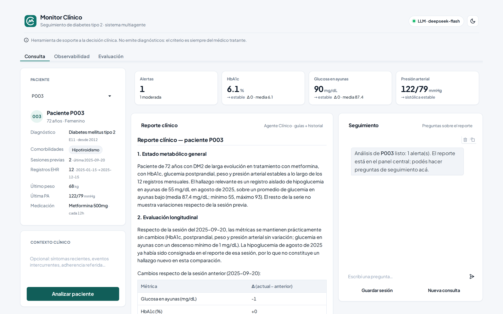
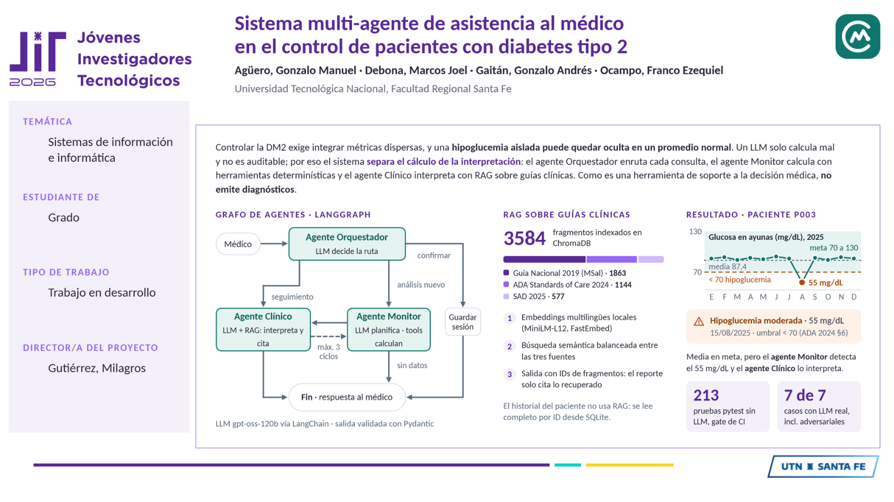

# Monitor Clínico: sistema multi-agente de soporte clínico para diabetes tipo 2

Sistema multi-agente basado en LangGraph para el seguimiento de pacientes con diabetes tipo 2. Tres
agentes coordinados (Orquestador, Monitor y Clínico) analizan el historial del paciente, detectan
valores fuera de las metas de control y generan un reporte estructurado con referencias a guías
clínicas (RAG). Es una herramienta de soporte a la decisión médica y no emite diagnósticos.

Repositorio remoto: https://github.com/MarcosDebona25/TP2-IA-2026.git



## Funcionalidades

| Funcionalidad | Descripción |
|---|---|
| Pipeline multi-agente | El Orquestador enruta la consulta al Monitor (análisis) y luego al Clínico (reporte), con loop de refinamiento. Las preguntas de seguimiento van directo al Clínico. |
| Análisis cuantitativo | Estadísticas determinísticas por métrica (último valor, media, mínimo, máximo, variación y dirección) y detección de hiper e hipoglucemia según las metas de control de DM2, que no son criterios diagnósticos ([ADR-0011](docs/adr/0011-metas-de-control-dm2.md)). |
| RAG sobre guías clínicas | El Clínico recupera fragmentos de guías ADA, SAD y Guía Nacional desde ChromaDB, con embeddings multilingües locales y recuperación balanceada entre fuentes ([ADR-0017](docs/adr/0017-embeddings-multilingues-y-balance-de-fuentes.md)). |
| Reporte estructurado | El reporte tiene seis secciones fijas. Cada alerta cita fragmentos por id y las cifras se validan contra el análisis del Monitor ([ADR-0019](docs/adr/0019-reporte-estructurado-y-generacion-anclada.md)). |
| Historial de pacientes | Incluye perfil clínico, EHR y comparación con la última sesión guardada (SQLite local, MongoDB opcional). La sesión se guarda solo a pedido del médico ([ADR-0008](docs/adr/0008-guardado-explicito-de-sesion.md)). |
| Interfaz web (Gradio) | Pestañas Consulta (perfil, indicadores, reporte, alertas, tendencias y chat de seguimiento), Observabilidad y Evaluación. Incluye tema claro y oscuro y tipografía embebida ([ADR-0021](docs/adr/0021-sistema-visual-de-la-interfaz.md)). |
| LLM intercambiable | Admite Groq, Gemini, OpenRouter o cualquier API compatible con OpenAI (incluida DeepSeek), con cadena de respaldo entre proveedores ([ADR-0020](docs/adr/0020-proveedores-openai-compatibles-y-cadena-entre-proveedores.md)). |
| Modo de ejecución visible | Sin API key, o si el LLM falla, el grafo corre con resultados determinísticos y la barra superior de la UI lo indica ([ADR-0018](docs/adr/0018-modo-de-ejecucion-visible.md)). |
| Observabilidad y evaluación | Logs en consola y en `logs/agent.jsonl` (integrables con LangSmith), más evaluación cualitativa sobre 12 casos: 3 happy path, 5 edge case y 4 adversariales. |

## Póster JIT 2026

Póster presentado en JIT 2026 (Jóvenes Investigadores Tecnológicos).

[](docs/publicaciones/jit/Poster%20JIT%202026.pdf)

Archivos: [póster (PDF)](docs/publicaciones/jit/Poster%20JIT%202026.pdf) y [presentación de la exposición (PDF)](docs/publicaciones/jit/JIT%202026%20%C2%B7%20Sistema%20multi-agente%20DM2.pdf).

## Instalación y ejecución

El único requisito es [uv](https://docs.astral.sh/uv/), que instala Python 3.12 o superior
automáticamente. No se necesita Docker, MongoDB ni Ollama: el historial es un archivo SQLite local
y los embeddings del RAG corren en proceso ([plan MVP](docs/planificacion/plan_mvp.md)).

```bash
uv sync                      # instala las dependencias y crea el .venv
cp .env.example .env         # crea el entorno (en Windows: Copy-Item .env.example .env); la key del proveedor se completa en este archivo
uv run python main.py        # prepara el historial y el índice de guías si faltan, y abre la UI
```

La interfaz queda disponible en http://127.0.0.1:7860. En la primera ejecución, `main.py` indexa
las guías clínicas (unos 6 minutos y 220 MB del modelo de embeddings). Las ejecuciones siguientes
arrancan en segundos y conservan las sesiones guardadas.

Sin API key, el sistema funciona en modo determinístico (sin LLM) y la UI lo indica. El proveedor se
define con `LLM_PROVIDER` en `.env` (detalle en `.env.example`):

| Proveedor | Variables | Modelo por defecto |
|---|---|---|
| `groq` (por defecto) | `GROQ_API_KEY` (gratuita en [console.groq.com](https://console.groq.com/keys)) | `openai/gpt-oss-120b` ([ADR-0014](docs/adr/0014-modelo-groq-gpt-oss.md)) |
| `gemini` | `GOOGLE_API_KEY` o `GEMINI_API_KEY` | `gemini-2.5-flash-lite` |
| `openrouter` | `OPENROUTER_API_KEY` | `deepseek/deepseek-v4-flash` (unos 0,0005 USD por análisis) |
| `openai_compat` | `LLM_API_KEY` y `LLM_BASE_URL` | `gpt-4o-mini` |

Con la API de DeepSeek (`LLM_PROVIDER=openai_compat`, `LLM_BASE_URL=https://api.deepseek.com`,
`LLM_MODEL=deepseek-flash`), el razonamiento se desactiva automáticamente ([ADR-0022](docs/adr/0022-deepseek-sin-razonamiento.md)).

Archivos generados y cómo regenerarlos:

| Ubicación | Contenido | Regeneración |
|---|---|---|
| `data/tp2.db` | Historial de pacientes y sesiones guardadas (SQLite) | `uv run python data/load_history.py` (conserva las sesiones) |
| `data/chroma_db/` | Índice de las guías clínicas | `uv run python rag/ingest.py --rebuild` |
| `logs/agent.jsonl` | Trazas estructuradas | Se crea automáticamente |
| `logs/eval_report.json` | Historial de corridas de evaluación | `uv run python tests/eval_runner.py` |

Opciones de `main.py`: `--port 7861`, `--skip-index` (no indexa) y `--no-ui` (solo prepara los datos).
La configuración de MongoDB u Ollama se describe en [ADR-0005](docs/adr/0005-historial-en-sqlite-local.md),
[ADR-0006](docs/adr/0006-embeddings-locales-sin-ollama.md) y [docker/README.md](docker/README.md).

## Verificación

### Tests

```bash
uv run pytest -m "not integration and not llm"   # gate determinístico, sin LLM (unos 5 s)
uv run pytest -m integration                      # retrieval real (requiere el índice de guías)
```

En el gate determinístico, todos los tests deben pasar. Los `xfailed` son los tests de regresión de
`tests/test_regresiones.py`, asociados a bugs pendientes de [docs/plan_correcciones.md](docs/plan_correcciones.md).
Los `deselected` son los de integración y el test estocástico que invoca al LLM real. La estrategia
de testing se describe en [docs/tecnica/tests.md](docs/tecnica/tests.md).

### Pestaña Consulta

Se selecciona un paciente en la barra lateral, se agrega contexto clínico de forma opcional y se
presiona Analizar paciente. El sistema devuelve indicadores, reporte, alertas y tendencias. Cada
paciente del fixture ejercita un caso distinto:

| Paciente | Caso | Comportamiento esperado |
|---|---|---|
| P001 | Controlado | Reporte sin alertas (happy path). |
| P002 | Tendencia ascendente | 17 alertas moderadas en el segundo semestre (ayunas > 130, HbA1c ≥ 7 %, postprandial ≥ 180) y dirección `subiendo`. |
| P003 | Episodio de hipoglucemia | 1 alerta de hipoglucemia moderada (un mes con glucosa en ayunas de 55 mg/dL, visible en el mínimo aunque la media lo diluya). La HbA1c de 6,1 % indica buen control. |
| P004 | Datos insuficientes | Una sola fila. El reporte indica que no hay datos suficientes para evaluar la evolución. |
| P005 | Descompensación severa | 35 alertas, 21 de ellas severas: HbA1c > 9 %, ayunas > 300 mg/dL y una hipoglucemia < 54 mg/dL. |

El chat de seguimiento responde preguntas sobre el reporte generado, y esas preguntas van directo al
Clínico. Guardar sesión persiste el análisis para la próxima comparación y Nueva consulta limpia la
pantalla.

### Pestañas Observabilidad y Evaluación

En Observabilidad, el botón Refrescar muestra la traza estructurada del grafo después de una consulta.
El modo básico muestra eventos `node_start` y `routing`, y el modo completo agrega `llm_*` y `tool_*`
(con tokens y nombre de tool). Las trazas también pueden consultarse desde la terminal:

```bash
cat logs/agent.jsonl | jq
```

En Evaluación se selecciona una corrida y un caso para comparar el comportamiento esperado con la
salida obtenida. Las corridas se generan con:

```bash
uv run python tests/eval_runner.py                 # todos los casos (nueva corrida)
uv run python tests/eval_runner.py -c happy        # una categoría
uv run python tests/eval_runner.py --case edge_03  # un caso
```

Documentación relacionada: [logs](docs/tecnica/logs.md), [interfaz](docs/tecnica/interfaz.md) y
[capturas de cada pantalla](docs/README.md#capturas-de-la-interfaz).

## Estructura del repositorio

```
main.py         punto de entrada: bootstrap (historial + índice) y UI
orchestrator/   state.py (estado + modelos) · graph.py (grafo LangGraph) · router.py (routing)
agents/         prompts.py · monitor.py · clinical.py · report.py (reporte anclado) · context.py · llm_factory.py
tools/          patient_tools.py · threshold_tools.py · history_store.py · history_tools.py · rag_tools.py
rag/            config.py (embeddings) · ingest.py (indexa en ChromaDB) · retriever.py (búsqueda)
data/           generate_patients.py · load_history.py · guias/ · sample/ (fixture P001-P005)
interface/      app.py (UI Gradio) · components.py (render) · theme.py (sistema visual) · assets/ · logging_config.py
scripts/        html_a_markdown.py (conversión de las guías ADA)
tests/          tests de pytest · eval_runner.py · cases/ (12 casos de evaluación)
docker/         MongoDB opcional
docs/           documentación (índice en docs/README.md)
```

Contenido de `docs/` ([índice completo](docs/README.md)):

```
CLAUDE.md               guía del proyecto (arquitectura, convenciones, estado)
plan_correcciones.md    correcciones pendientes
adr/                    decisiones de arquitectura
consigna/               enunciado y definición conceptual
tecnica/                interfaz, logs, tests y diagramas de arquitectura
planificacion/          estado, plan MVP y roadmap
capturas/               capturas de la UI actual + capturar.py
branding/               logo e isotipo
publicaciones/          conaiisi/ (paper) · jit/ (póster y presentación expuestos) · jit/articulo/ · jit/presentacion/
```

## Comandos útiles

```bash
uv sync                              # instala o actualiza el entorno
uv run pytest -m "not integration and not llm"   # gate determinístico (sin infraestructura ni LLM)
uv run pytest                        # suite completa (requiere índice de guías y API key)
uv run python -m interface.app       # levanta solo la interfaz web
uv run python tests/eval_runner.py --list        # lista los casos de evaluación
uv lock                              # regenera el lockfile tras cambiar dependencias
```

## Graphify

El repositorio incluye la configuración de [graphify](https://github.com/Graphify-Labs/graphify) para
asistentes de código (skill en `.claude/skills/graphify/` y hooks en `.claude/settings.json`). Los hooks
llaman a `graphify` por PATH, por lo que cada integrante debe instalarlo. Sin esa instalación, el
asistente muestra un error no bloqueante en cada lectura. La decisión se documenta en
[ADR-0002](docs/adr/0002-graphify-para-navegacion-del-codigo.md).

```bash
uv tool install "graphifyy[office]"        # paquete en PyPI (nombre con doble "y"; [office] lee .docx)
graphify install --project --platform claude   # reinstala la skill y los hooks si hace falta
```

Construcción del índice completo (código, documentos y diagramas) desde Claude Code:

```
/graphify .            # primera vez: AST local + paso semántico con subagentes del asistente
/graphify . --update   # después: re-extrae solo lo que cambió (incluye docs)
```

Mantenimiento y consultas desde la terminal, sin costo de LLM:

```bash
graphify update .                          # refresca solo el código tras cambios
graphify query "¿qué nodos usan AgentState?"
```

El punto de entrada para navegar es `graphify-out/wiki/index.md`. Lo que queda fuera del grafo (guías
clínicas, capturas y archivos de la skill) se define en `.graphifyignore`. `graphify-out/` no se
versiona porque es un artefacto regenerable.
