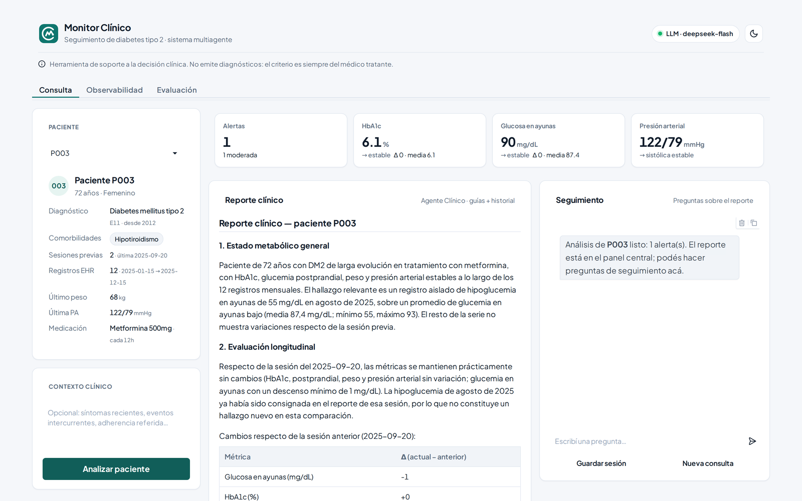

# Monitor Clínico — Sistema Multi-Agente de Soporte Clínico para Diabetes tipo 2

Sistema multi-agente (LangGraph) de **soporte a la decisión clínica** para el seguimiento de
pacientes con diabetes tipo 2. Tres agentes coordinados —**Orquestador**, **Monitor** y
**Clínico**— analizan el historial del paciente, detectan valores fuera de las metas de control y
producen un reporte estructurado consultando guías clínicas (RAG). **No emite diagnósticos.**

**Link del repositorio remoto**: https://github.com/MarcosDebona25/TP2-IA-2026.git



---

## Funcionalidades

| # | Funcionalidad | Descripción |
|---|---|---|
| 1 | **Pipeline multi-agente** | El Orquestador enruta la consulta → Monitor (análisis) → Clínico (reporte), con loop de refinamiento; las preguntas de seguimiento van directo al Clínico. Orquestado con LangGraph. |
| 2 | **Análisis cuantitativo determinístico** | Estadísticas por métrica (último, media, mín, máx, Δ, dirección) y detección de valores fuera de las **metas de control de DM2** (no criterios diagnósticos): hiper **e** hipoglucemia ([ADR-0011](docs/adr/0011-metas-de-control-dm2.md)). |
| 3 | **RAG sobre guías clínicas** | El Clínico fundamenta el reporte con fragmentos de guías (ADA / SAD / Guía Nacional) recuperados de ChromaDB con embeddings multilingües locales y recuperación balanceada entre fuentes ([ADR-0017](docs/adr/0017-embeddings-multilingues-y-balance-de-fuentes.md)). |
| 4 | **Reporte estructurado con generación anclada** | Seis secciones fijas; cada alerta cita fragmentos por id y las cifras se validan contra el análisis del Monitor, sin inventar valores ([ADR-0019](docs/adr/0019-reporte-estructurado-y-generacion-anclada.md)). |
| 5 | **Historial de pacientes** | Perfil clínico, EHR y comparación con la última sesión guardada (SQLite local; MongoDB opcional). La sesión se guarda solo a pedido del médico ([ADR-0008](docs/adr/0008-guardado-explicito-de-sesion.md)). |
| 6 | **Interfaz web (Gradio)** | Pestañas *Consulta* (perfil, indicadores, reporte, alertas, tendencias y chat de seguimiento), *Observabilidad* y *Evaluación*. Tema claro/oscuro y tipografía embebida ([ADR-0021](docs/adr/0021-sistema-visual-de-la-interfaz.md)). |
| 7 | **LLM intercambiable con respaldo** | Groq, Gemini, OpenRouter o cualquier API compatible con OpenAI (DeepSeek incluido), con cadena de respaldo entre proveedores ([ADR-0020](docs/adr/0020-proveedores-openai-compatibles-y-cadena-entre-proveedores.md)). |
| 8 | **Modo de ejecución visible** | Sin API key, o si el LLM falla, el grafo corre con resultados determinísticos y la UI lo indica en la barra superior ([ADR-0018](docs/adr/0018-modo-de-ejecucion-visible.md)). |
| 9 | **Observabilidad y evaluación** | Logs en consola + `logs/agent.jsonl` estructurado (integrables con LangSmith) y evaluación cualitativa sobre 12 casos (3 happy path, 5 edge case, 4 adversariales). |

---

## Inicio rápido (3 comandos)

Requisito único: **[uv](https://docs.astral.sh/uv/)** (instala Python 3.12+ automáticamente).
No hace falta Docker, MongoDB ni Ollama: el historial es un archivo SQLite local y los embeddings
del RAG corren en proceso ([plan MVP](docs/planificacion/plan_mvp.md)).

```bash
uv sync                      # 1. instala dependencias (crea el .venv)
cp .env.example .env         # 2. crea el entorno (Windows: Copy-Item .env.example .env) y completá la key del proveedor
uv run python main.py        # 3. prepara historial + índice de guías (solo lo que falte) y abre la UI
```

Abrí **http://127.0.0.1:7860**. La primera vez, `main.py` indexa las guías clínicas (~6 min y
~220 MB del modelo de embeddings multilingüe); después arranca en segundos. Todo es idempotente: las sesiones
guardadas se conservan entre arranques.

**Sin API key** el sistema funciona igual en **modo determinístico** (fallbacks sin LLM) y la UI
lo avisa. Proveedores soportados (`LLM_PROVIDER` en `.env`; detalle en `.env.example`):

| Proveedor | Variables | Modelo por defecto |
|---|---|---|
| `groq` (por defecto) | `GROQ_API_KEY` (gratis en [console.groq.com](https://console.groq.com/keys)) | `openai/gpt-oss-120b` ([ADR-0014](docs/adr/0014-modelo-groq-gpt-oss.md)) |
| `gemini` | `GOOGLE_API_KEY` o `GEMINI_API_KEY` | `gemini-2.5-flash-lite` |
| `openrouter` | `OPENROUTER_API_KEY` | `deepseek/deepseek-v4-flash` (~0,0005 USD por análisis) |
| `openai_compat` | `LLM_API_KEY` + `LLM_BASE_URL` | `gpt-4o-mini` |

Con la API de DeepSeek (`LLM_PROVIDER=openai_compat`, `LLM_BASE_URL=https://api.deepseek.com`,
`LLM_MODEL=deepseek-flash`) el razonamiento se desactiva solo ([ADR-0022](docs/adr/0022-deepseek-sin-razonamiento.md)).

| Dónde vive | Qué | Cómo se regenera |
|---|---|---|
| `data/tp2.db` | Historial de pacientes y sesiones guardadas (SQLite) | `uv run python data/load_history.py` (conserva sesiones) |
| `data/chroma_db/` | Índice de las guías clínicas | `uv run python rag/ingest.py --rebuild` |
| `logs/agent.jsonl` | Trazas estructuradas | se crea solo |
| `logs/eval_report.json` | Historial de corridas de evaluación | `uv run python tests/eval_runner.py` |

Opciones: `main.py --port 7861`, `--skip-index` (no indexar), `--no-ui` (solo preparar).
Para usar MongoDB u Ollama: [ADR-0005](docs/adr/0005-historial-en-sqlite-local.md),
[ADR-0006](docs/adr/0006-embeddings-locales-sin-ollama.md), [docker/README.md](docker/README.md).

---

## Cómo verificar que funciona

### 1. Tests

```bash
uv run pytest -m "not integration and not llm"   # gate determinístico, sin LLM (~5 s)
uv run pytest -m integration                      # retrieval real (requiere el índice de guías)
```

**Esperado del gate:** todo en verde; los `xfailed` son los tests de regresión de
`tests/test_regresiones.py` (bugs pendientes de [docs/plan_correcciones.md](docs/plan_correcciones.md)).
Los `deselected` son los de integración + el test estocástico que invoca al LLM real.
Estrategia de testing completa en [docs/tecnica/tests.md](docs/tecnica/tests.md).

### 2. Interfaz — Consulta

En la pestaña **Consulta**: elegí un paciente en la barra lateral, opcionalmente escribí un contexto
clínico (información adicional para que el agente tenga en cuenta) y presioná **Analizar paciente**.
El sistema devuelve **indicadores + reporte + alertas + tendencias**. Cada paciente del fixture
ejercita un caso distinto:

| Paciente | Caso | Comportamiento esperado |
|---|---|---|
| **P001** | Controlado | Reporte **sin alertas** (happy path). |
| **P002** | Tendencia ascendente | **17 alertas moderadas** en el segundo semestre (ayunas > 130, HbA1c ≥ 7 %, postprandial ≥ 180) y dirección `subiendo`. |
| **P003** | Episodio de hipoglucemia | **1 alerta de hipoglucemia moderada** (un mes con glucosa en ayunas = 55 mg/dL; el `mín` lo expone aunque la media lo diluya). HbA1c 6.1 % es buen control. |
| **P004** | Datos insuficientes | Una sola fila → el reporte explicita que no hay datos suficientes para evaluar la evolución. |
| **P005** | Descompensación severa | **35 alertas** (21 severas): HbA1c > 9 %, ayunas > 300 mg/dL y una hipoglucemia < 54 mg/dL. |

El **chat de seguimiento** responde preguntas sobre el reporte ya generado (van directo al Clínico).
**Guardar sesión** persiste el análisis para la próxima comparación; **Nueva consulta** limpia la pantalla.

### 3. Interfaz — Observabilidad y Evaluación

En la pestaña **Observabilidad**: presioná **Refrescar** tras una consulta para ver la traza
estructurada del grafo. En modo básico aparecen eventos `node_start` y `routing`; en modo
completo se suman `llm_*` y `tool_*` (con tokens y nombre de tool). También desde la terminal:

```bash
cat logs/agent.jsonl | jq
```

En la pestaña **Evaluación** se elige una corrida y un caso para comparar el comportamiento esperado
con la salida obtenida. Las corridas se generan con:

```bash
uv run python tests/eval_runner.py                 # todos los casos (nueva corrida)
uv run python tests/eval_runner.py -c happy        # una categoría
uv run python tests/eval_runner.py --case edge_03  # un caso
```

Detalle de los campos y eventos: [docs/tecnica/logs.md](docs/tecnica/logs.md). Más sobre la UI:
[docs/tecnica/interfaz.md](docs/tecnica/interfaz.md). Capturas de cada pantalla: [docs/capturas/](docs/README.md#capturas-de-la-interfaz).

---

## Estructura del repo

```
main.py         punto de entrada: bootstrap (historial + índice) y UI
orchestrator/   state.py (estado + modelos) · graph.py (grafo LangGraph) · router.py (routing)
agents/         prompts.py · monitor.py · clinical.py · report.py (reporte anclado) · context.py · llm_factory.py
tools/          patient_tools.py · threshold_tools.py · history_store.py · history_tools.py · rag_tools.py
rag/            config.py (embeddings) · ingest.py (indexa en ChromaDB) · retriever.py (búsqueda)
data/           generate_patients.py · load_history.py · guias/ · sample/ (fixture P001-P005)
interface/      app.py (UI Gradio) · components.py (render) · theme.py (sistema visual) · assets/ · logging_config.py
scripts/        html_a_markdown.py (conversión de las guías ADA)
tests/          tests de pytest · eval_runner.py · cases/ (12 casos de evaluación)
docker/         MongoDB opcional
docs/           documentación (índice en docs/README.md)
```

`docs/` se organiza así ([índice completo](docs/README.md)):

```
CLAUDE.md               guía del proyecto (arquitectura, convenciones, estado)
plan_correcciones.md    correcciones pendientes
adr/                    decisiones de arquitectura
consigna/               enunciado y definición conceptual
tecnica/                interfaz, logs, tests y diagramas de arquitectura
planificacion/          estado, plan MVP y roadmap
capturas/               capturas de la UI actual + capturar.py
branding/               logo e isotipo
publicaciones/          conaiisi/ (paper) · jit/articulo/ · jit/presentacion/
```

---

## Comandos útiles

```bash
uv sync                              # instalar / actualizar el entorno
uv run pytest -m "not integration and not llm"   # gate determinístico (sin infra ni LLM)
uv run pytest                        # toda la suite (requiere índice de guías y API key)
uv run python -m interface.app       # levantar solo la interfaz web
uv run python tests/eval_runner.py --list        # listar los casos de evaluación
uv lock                              # regenerar el lockfile tras cambiar dependencias
```

---

## Herramientas de desarrollo: graphify

El repo trae configurado [graphify](https://github.com/Graphify-Labs/graphify) para asistentes de código
(skill en `.claude/skills/graphify/` y hooks en `.claude/settings.json`). Los hooks llaman a `graphify`
por PATH, así que **cada integrante tiene que instalarlo** (si no, el asistente muestra un error no
bloqueante en cada lectura). Decisión y detalles: [ADR-0002](docs/adr/0002-graphify-para-navegacion-del-codigo.md).

```bash
uv tool install "graphifyy[office]"        # paquete oficial en PyPI (ojo: doble "y"; [office] lee .docx)
graphify install --project --platform claude   # (re)instala skill + hooks si hace falta
```

Construir el índice completo (código + documentos + diagramas) desde Claude Code:

```
/graphify .            # primera vez: AST local + paso semántico con subagentes del asistente
/graphify . --update   # después: re-extrae solo lo que cambió (docs incluidos)
```

Mantenimiento y consultas desde la terminal (sin costo de LLM):

```bash
graphify update .                          # refresca SOLO el código tras cambios
graphify query "¿qué nodos usan AgentState?"
```

Punto de entrada para navegar: `graphify-out/wiki/index.md`. Qué queda afuera del grafo (guías clínicas,
capturas, archivos de la skill): ver `.graphifyignore`.

`graphify-out/` no se versiona: es un artefacto regenerable.
